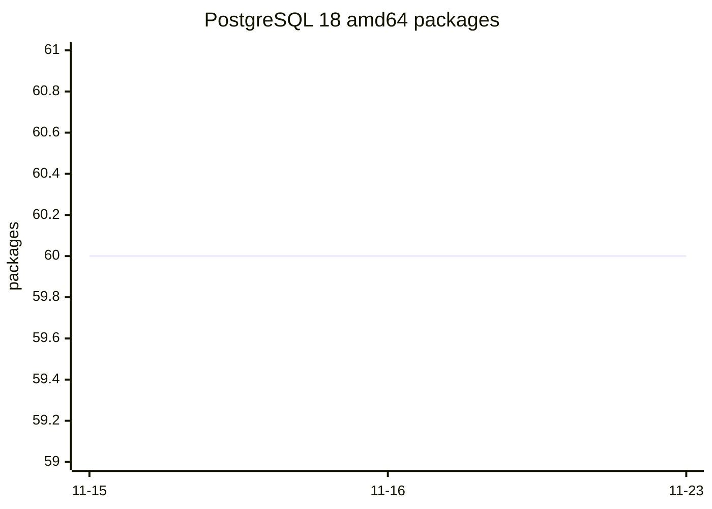

<!--
SPDX-FileCopyrightText: 2026 OpenSerbia
SPDX-License-Identifier: MIT
-->
# Package count

Each point is one published rebuild of `ghcr.io/openserbia/postgres-wolfi`.
The number is how many CycloneDX components have a `pkg:apk` purl.
The count comes from the SBOM attested to that image. Charts are linux/amd64.
A rebuild on the same day stays as its own point. The chart shows the
last 24 points. `history.tsv` on this branch is the source. The workflow
rewrites this page from that file.

## PostgreSQL 18

## Recent publishes

amd64 and arm64 are counted separately. The PostgreSQL column is the
version of the `postgresql-<major>` package on amd64.

| Date | Run | Major | amd64 | arm64 | PostgreSQL |
|------|-----|-------|-------|-------|------------|
| 2026-11-23 | [45233934911](https://github.com/openserbia/postgres-wolfi/actions/runs/45233934911) | 18 | 60 | 60 | 18.7-r0 |
| 2026-11-16 | [43899049766](https://github.com/openserbia/postgres-wolfi/actions/runs/43899049766) | 18 | 60 | 60 | 18.7-r0 |
| 2026-11-15 | [43721685510](https://github.com/openserbia/postgres-wolfi/actions/runs/43721685510) | 18 | 60 | 60 | 18.7-r0 |
